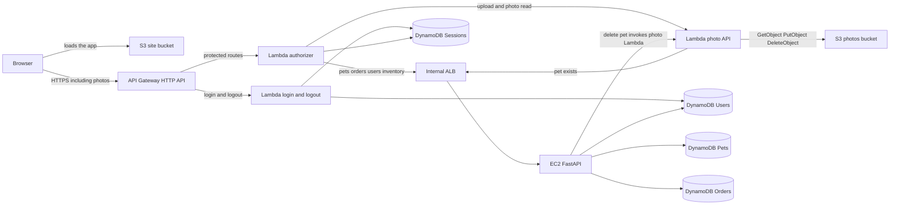
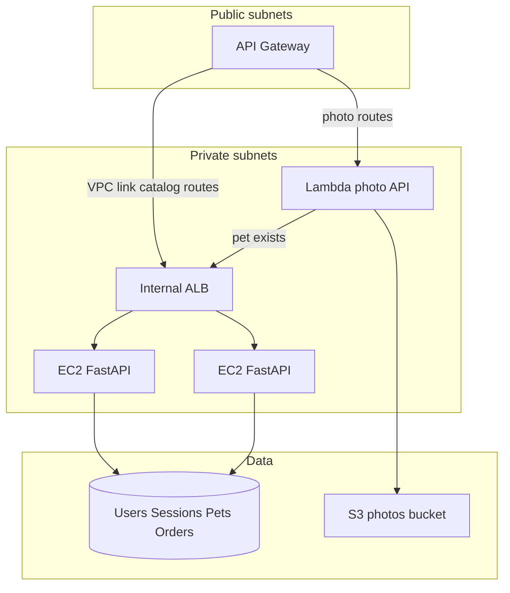
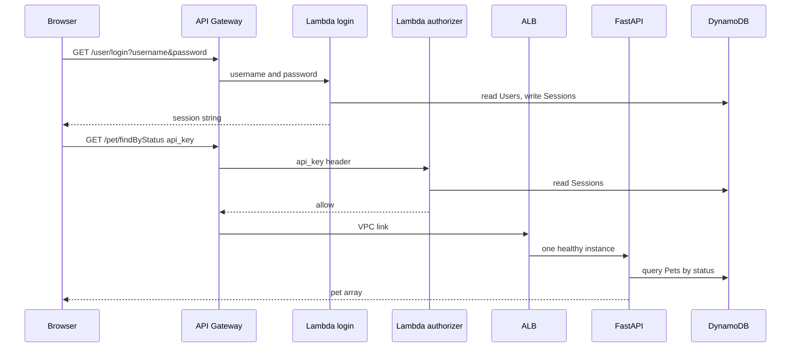
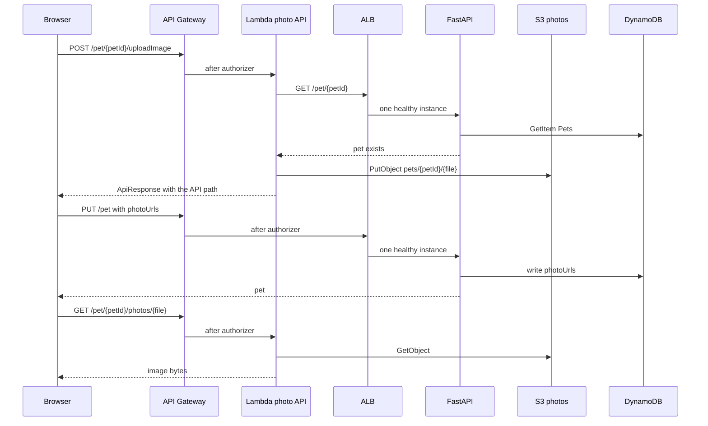
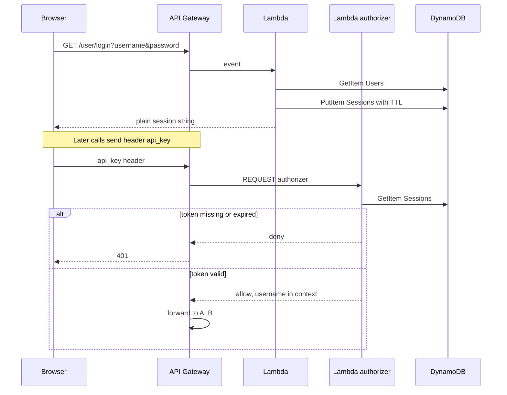
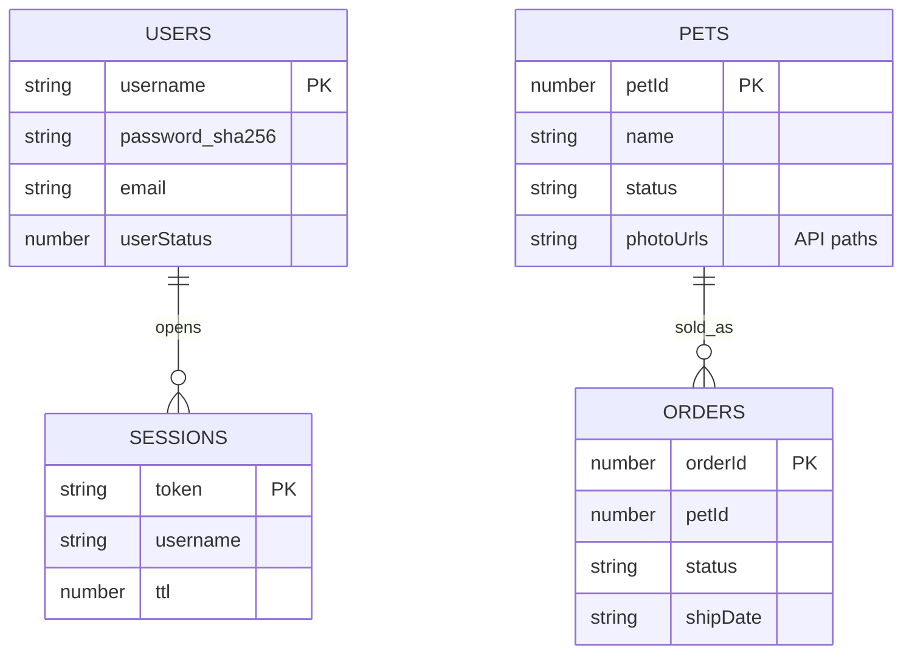

# Pet store workshop

Your group shares one stack: one UI, one HTTP API, one internal load balancer, two EC2 hosts, and one set of tables. The UI is live at [https://d38lfdqs4v6jcx.cloudfront.net/?theme=kawaii-neko](https://d38lfdqs4v6jcx.cloudfront.net/?theme=kawaii-neko). You reach the hosts with Session Manager from your jumpbox. The hosts have no public IP and no SSH.

You do not create the VPC, subnets, route tables, security groups, endpoints, the API, the VPC link, CORS, or any IAM role. Pass the roles that already exist.

## The UI

Use the live site as it is: [https://d38lfdqs4v6jcx.cloudfront.net/?theme=kawaii-neko](https://d38lfdqs4v6jcx.cloudfront.net/?theme=kawaii-neko). It is a React app for browsing and managing pets, orders, inventory, and users. It can run on seeded data in the browser, or sign in to a Petstore-compatible API.

The source is on GitHub if you want to change the UI during the workshop: [petstore-ui](https://github.com/paddypawprints/petstore-ui). Clone that repository, then follow its README for a local run. Node.js 20.19+ or 22.12+ and npm are enough. `npm ci` then `npm run dev` prints a local URL, usually `http://localhost:5173`.

The app starts in local mode, which needs no API. Sign in as `ada` with password `lovelace`. The catalog is seeded in memory. A reload drops your edits. Signing out restores the seed.


After you sign in, open Backend in the sidebar. The suggested endpoint is `https://petstore3.swagger.io/api/v3`. Turn on Demo mode and save. Saving a backend signs you out. Sign in again with credentials that server accepts. The app sends the login token in the `api_key` header when it loads the catalog. The endpoint must allow browser CORS, including that header.

Server mode authenticates, then loads pets, orders, and users from the API. Later edits stay in the browser. They are not written back to the server.


The same site serves Swagger. It loads `/petstore.yaml`.


The theme on the workshop link is `kawaii-neko`. Change it in the theme menu, or set `?theme=` on the URL.

## Architecture

The browser loads a static site. It calls only API Gateway. Pet photos are objects in a private S3 bucket. A Lambda handles the photo API and is the only thing that writes that bucket. FastAPI on the two EC2 hosts handles catalog transactions and is the only thing that writes DynamoDB for pets, orders, and users. The internal load balancer spreads those requests across the two hosts. API Gateway sends each route to one integration, so it cannot choose a host by itself.

`GET /user/login?username&password` returns a session string. Later calls send that string in the `api_key` header. The spec's OAuth flow is not part of this deployment.

### System



| Service | Role |
|---------|------|
| S3 site bucket | The static site: `index.html`, hashed assets, `swagger.html`, `petstore.yaml`. |
| S3 photos bucket | Private. Image bytes for `uploadImage`. The browser never calls S3. |
| API Gateway | Public API. One integration per route. |
| Lambda | Login, logout, the `api_key` authorizer, and the photo API. The photo function has no DynamoDB permissions. |
| ALB | Health checks and load balancing across the two FastAPI hosts. |
| EC2 | FastAPI for pets, orders, inventory, and user records. Stateless. |
| DynamoDB | Users, sessions, pets, and orders. Catalog writes go through FastAPI. |

The HTTP API uses a VPC link to the internal load balancer. Login, logout, and the photo routes are Lambda integrations. Before the photo function writes an object, it calls the load balancer to ask whether that pet exists.

### Network



Only the VPC link and the photo Lambda can reach the load balancer. FastAPI has no permission to read or write the photos bucket. Block Public Access stays on. The load balancer health check is `GET /health` on the FastAPI process. That path is not an OpenAPI route and is not on API Gateway.

No inbound rule uses `0.0.0.0/0`.

| Security group | Inbound | Outbound |
|----------------|---------|----------|
| VPC link | none | ALB security group, port 443 |
| ALB | VPC link security group, and the photo Lambda security group, port 443 | FastAPI security group, app port |
| FastAPI | ALB security group, app port | DynamoDB and S3 gateway endpoints, interface endpoints, and HTTP/HTTPS to the internet |
| Photo Lambda | none | S3 gateway endpoint, the ALB security group, and interface endpoints |

### Request paths



| OpenAPI | Integration |
|---------|-------------|
| `GET /user/login`, `GET /user/logout` | Lambda. No authorizer. |
| `POST /user`, `POST /user/createWithList` | ALB to FastAPI. No authorizer. The spec leaves these open. |
| Pet, order, inventory, and `GET/PUT/DELETE /user/{username}` | Lambda authorizer, then ALB to FastAPI to DynamoDB. |
| `POST /pet/{petId}/uploadImage`, `GET /pet/{petId}/photos/{file}` | Lambda authorizer, then the photo Lambda to S3. |

`GET /store/inventory` is computed. FastAPI counts pets by status. There is no inventory table.

`POST /pet/{petId}/uploadImage` stores `pets/{petId}/{file}` in the private bucket. The response is the spec's `ApiResponse`, and its message is the API path `/pet/{petId}/photos/{file}`. That path is not an S3 URL. `GET /pet/{petId}/photos/{file}` streams the object back.

Saving the path onto the pet is a catalog write. The browser sends it on `PUT /pet`, and FastAPI writes `photoUrls`. Before the photo Lambda writes an object, it asks FastAPI, through the internal load balancer, whether that pet exists. A missing pet returns 404 and nothing is stored. FastAPI never calls S3. When a pet is deleted, FastAPI removes the DynamoDB item and invokes the photo Lambda to delete that pet's prefix.



### Auth



Hash the submitted password and compare it to `password_sha256` on the Users item. A match writes a Sessions item with a one-hour TTL and returns the session string as the body. Logout deletes that item. FastAPI does not read the `api_key` header to decide access. It reads the username the authorizer already checked.

You write the login function and attach `GET /user/login`. You also write the authorizer function and attach it to the protected routes. The logout function is not yours to create. The logout role can `DeleteItem` on Sessions.

### Checking the token

Lab 25 attached a route straight to a Lambda. That route does not check a caller. This API does, on every protected route in the table above. The check is a Lambda authorizer. It is not an API Gateway usage-plan API key. The UI sends the session string in the `api_key` header because that is the pet-store security scheme.

Create the function `petstore-g1-authorizer` with the role of the same name. That role can `GetItem` on Sessions and write logs. Allow API Gateway to invoke the function, the same `AddPermission` call you use for the other functions, with principal `apigateway.amazonaws.com`.

The handler receives an HTTP API payload. Read the token from `event["headers"]["api_key"]`. `GetItem` Sessions with that token as the key. Allow the call only when the item exists and `ttl` is still in the future. Return a simple response:

```python
{"isAuthorized": True, "context": {"username": username}}
```

A missing or expired token returns `{"isAuthorized": False}`. Context values are strings.

Create the authorizer on the existing API. `AuthorizerUri` is not the function ARN. It is `arn:aws:apigateway:<region>:lambda:path/2015-03-31/functions/<function-arn>/invocations`.

```python
api.create_authorizer(
    ApiId=api_id,
    Name="petstore-g1-authorizer",
    AuthorizerType="REQUEST",
    AuthorizerUri=authorizer_uri,
    IdentitySource=["$request.header.api_key"],
    AuthorizerPayloadFormatVersion="2.0",
    EnableSimpleResponses=True,
    AuthorizerResultTtlInSeconds=0,
)
```

`AuthorizerResultTtlInSeconds=0` makes every call check Sessions. A cached allow would keep working after logout deleted the item.

On each protected route, set `AuthorizationType="CUSTOM"` and `AuthorizerId` to the id just returned. `GET /user/login`, `GET /user/logout`, and the open `POST /user` routes stay without an authorizer.

The load-balancer integration does not receive that context on its own. Update it so FastAPI gets the username in a header:

```python
api.update_integration(
    ApiId=api_id,
    IntegrationId=catalog_integration_id,
    RequestParameters={
        "overwrite:header.x-username": "$context.authorizer.lambda.username",
    },
)
```

FastAPI reads `x-username`. The photo function reads `event["requestContext"]["authorizer"]["lambda"]["username"]`. Print `requestContext.authorizer` once if that key is missing, and use the username field that is there.

### Challenge: the password is in the URL

`GET /user/login` puts the password in the query string. That is the pet-store operation, and the UI calls it. Leave the operation as it is. A different method or a body field is a different API, and this client will not log in.

The URL is the problem. API Gateway access logs, the browser history, and any copy of the link contain the password. HTTPS encrypts the request on the wire and does not keep it out of those logs.

Hashing the password in the browser and sending the hash as the query parameter does not fix it. The hash is then the credential. Anyone who reads the URL can send it again and log in.

Write down what you would change, and which client call would have to change with it. Implement the login function against the operation above.

### Data



| Table | Key | Access |
|-------|-----|--------|
| Users | `username` | Login lookup. User create, read, update, delete. `password_sha256` is the hex SHA-256 of the password bytes. No salt, no newline. |
| Sessions | `token` | Login write, authorizer read, logout delete. TTL attribute `ttl`. |
| Pets | `petId` | Get, update, delete. Global secondary index on `status` for `findByStatus` and inventory counts. `photoUrls` holds API paths. |
| Orders | `orderId` | Get, place, delete. |

All four tables are on-demand. Only the key attributes are declared on the table. `findByTags` stays on the reference host unless your group finishes early.

The photo object key is `pets/{petId}/{filename}`. An `img` tag uses the API path.

Either FastAPI host can serve any request. Session and catalog data stay in DynamoDB.

## Already running

Names use the prefix `petstore`.

| Piece | Name |
|-------|------|
| Users table | `petstore-g1-users` |
| Sessions table | `petstore-g1-sessions` |
| Login role and function | `petstore-g1-login` |
| Authorizer role and function | `petstore-g1-authorizer` |
| Photo role and function | `petstore-g1-photos` |
| Photos bucket | `petstore-<account-id>-g1-photos` |
| Pets table | `petstore-g1-pets` |
| Orders table | `petstore-g1-orders` |

Users and Sessions already exist. Users has no items. Seed them from the jumpbox. The login role can `GetItem` on Users and `PutItem` on Sessions. The authorizer role can `GetItem` on Sessions. The photo role can `GetObject`, `PutObject`, and `DeleteObject` on the photos bucket. Create the functions with those roles. Create the photos bucket in this region with Block Public Access on. Create Pets and Orders yourself.

The HTTP API, the VPC link, CORS, and the load-balancer integration already exist. Add routes and integrations. Do not create another API.

Both EC2 hosts run Ubuntu 24.04. systemd is enabled and the hosts are registered on the load balancer. No pet-store app is on disk yet. Pull the same FastAPI app from GitHub onto both machines. A request can land on either host.

The UI you open is [https://d38lfdqs4v6jcx.cloudfront.net/?theme=kawaii-neko](https://d38lfdqs4v6jcx.cloudfront.net/?theme=kawaii-neko). It calls the API Gateway invoke URL. The group site bucket starts empty.

A reference stack is available for a route you do not finish:

- One EC2 host with a complete FastAPI catalog. Point an unfinished pet, order, or inventory route at its listener instead of your load balancer.
- Photo Lambdas for upload and read, and a private reference photos bucket. Point an unfinished photo route at those functions.

Your own code stays on the routes you completed.

## Access from the jumpbox

Work from the jumpbox. Its role can call the group resources in this section. Open a shell on a host when you are installing or running FastAPI.

The class region is `us-east-2`. Set it in the shell:

```bash
export AWS_DEFAULT_REGION=us-east-2
```

The jumpbox role can:

- Read and write items in `petstore-g1-users`, `petstore-g1-sessions`, `petstore-g1-pets`, and `petstore-g1-orders`, including indexes. Create, update, and delete the Pets and Orders tables. Users and Sessions already exist, and this role cannot delete them.
- Create the photos bucket `petstore-<account-id>-g1-photos` in this region, turn on Block Public Access, list the `pets/` prefix, and get, put, and delete objects under `pets/`.
- Create, update, delete, and read `petstore-g1-login`, `petstore-g1-authorizer`, and `petstore-g1-photos`. Pass those three roles to Lambda. `AddPermission` is allowed for principal `apigateway.amazonaws.com`.
- Read and change routes, integrations, and authorizers on the existing HTTP API.
- Read CloudWatch logs for those three functions. The log group names are `/aws/lambda/petstore-g1-login`, `/aws/lambda/petstore-g1-authorizer`, and `/aws/lambda/petstore-g1-photos`.

```bash
aws logs filter-log-events --log-group-name /aws/lambda/petstore-g1-login --limit 20
```

The reference host, its tables, and its bucket are outside this role. The hosts have no public IP. SSH is closed.

### Confirm the jumpbox role

Run these calls on the jumpbox as the jumpbox role. An assumed lab session cannot make them. The pet-store grants stay on the jumpbox role.

```bash
aws sts get-caller-identity

aws ec2 describe-instances \
  --filters "Name=tag:Name,Values=petstore-g1-fastapi-1,petstore-g1-fastapi-2" \
            "Name=instance-state-name,Values=running" \
  --query "Reservations[].Instances[].[Tags[?Key=='Name']|[0].Value,InstanceId]" \
  --output text

aws dynamodb get-item --table-name petstore-g1-users \
  --key '{"username":{"S":"nobody"}}'
```

The caller ARN ends in your jumpbox role, such as `LabJumpboxRole-patrick`. The describe prints both hosts:

```
petstore-g1-fastapi-1	i-0294865d4c107ab5b
petstore-g1-fastapi-2	i-0044819841db18ca4
```

`get-item` prints nothing. There is no user named `nobody`. An empty reply means the table call was allowed.

### A shell on a group host

Session Manager reaches the two FastAPI hosts. `petstore-g1-fastapi-1` is `i-0294865d4c107ab5b`. `petstore-g1-fastapi-2` is `i-0044819841db18ca4`. From the jumpbox:

```bash
aws ssm start-session --target i-0294865d4c107ab5b
aws ssm start-session --target i-0044819841db18ca4
```

Each command opens one host. Exit that session before you run the next command.

`start-session` needs the Session Manager plugin. If the command reports it missing:

```bash
case "$(uname -m)" in
  x86_64) PLUGIN_ARCH=ubuntu_64bit ;;
  aarch64) PLUGIN_ARCH=ubuntu_arm64 ;;
  *) echo "Unsupported architecture: $(uname -m)" >&2; exit 1 ;;
esac
curl -fSL "https://s3.amazonaws.com/session-manager-downloads/plugin/latest/${PLUGIN_ARCH}/session-manager-plugin.deb" \
  -o /tmp/session-manager-plugin.deb
sudo dpkg -i /tmp/session-manager-plugin.deb
session-manager-plugin --version
```

Exit the session after it opens. The reference host is `i-08db49cca19f5aa15`. This call is denied:

```bash
aws ssm start-session --target i-08db49cca19f5aa15
```

`AccessDenied` is the result you want. A shell on that host means the grant includes the reference instance.

On the host, the shell uses the instance role `petstore-g1-fastapi`. That role reads and writes the four group tables and can invoke the photo function. Table creation, the photos bucket, the three functions, API routes, and CloudWatch logs stay on the jumpbox role.

`probe.service` is already running and listens on port 8080. The load balancer health check is `GET /health` on that port. When FastAPI takes the port, it has to answer `GET /health` with 200. Until then, host logs are `journalctl -u probe.service`. After you replace the unit, follow the unit you installed.

### FastAPI from GitHub

The FastAPI app, the Lambdas, and the rest of the work you write live in [petstore-workshop](https://github.com/paddypawprints/petstore-workshop). The UI is the separate repository linked above. Use the live site unless you are changing the UI.

Pull that repository onto the hosts over HTTPS. On each host, from the Session Manager shell:

```bash
sudo apt-get update && sudo apt-get install -y git
git clone https://github.com/paddypawprints/petstore-workshop.git
cd petstore-workshop
```

Push from your own machine. Then open a shell on `petstore-g1-fastapi-1` and `petstore-g1-fastapi-2` and run `git pull` in that directory. Both hosts run the same commit.

## Your work

How you organize is up to the team. The code you write goes in [petstore-workshop](https://github.com/paddypawprints/petstore-workshop).

Meet first and read this document. It is the project brief. Then decide the tasks.

Get the system ready for development before you split off to build features:

- Repository layout.
- Seed data.
- Creating the Pets and Orders tables.
- The photo bucket layout. The object key in the architecture is the contract the UI uses. The rest of the layout is yours to decide.
- How you will test.
- Monitoring and logs. Decide where the Lambda and FastAPI logs go, and how you tell a failed request from a healthy one.
- Deploy the FastAPI app by pulling [petstore-workshop](https://github.com/paddypawprints/petstore-workshop) on both hosts, and decide how you will deploy the Lambdas.
- A FastAPI skeleton.
- An integration plan: how a route calls the implementation behind it, including the login function, the authorizer, the load balancer, and the photo function.

DynamoDB was left off the labs. Plan time to research the client, the key types, and the status index before the catalog depends on them.

Decide how to split the work. The architecture diagram shows the seams. The assignment of people is yours.

Set check-ins. At each one, say what is working, what is blocked, and what the next stage is.

The login function, the authorizer, the catalog routes, and the photo routes are the work those stages have to finish. A route you do not finish points at the reference host or the reference photo functions. Your code stays on the routes you completed.

OpenAPI is `openapi/petstore.yaml`. That file is the contract FastAPI serves and the file Swagger loads.

Good luck and have fun.
